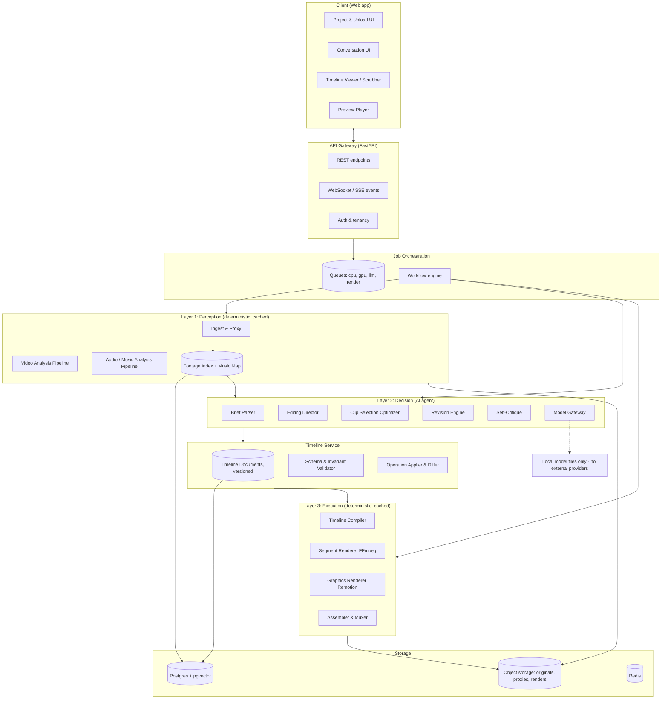
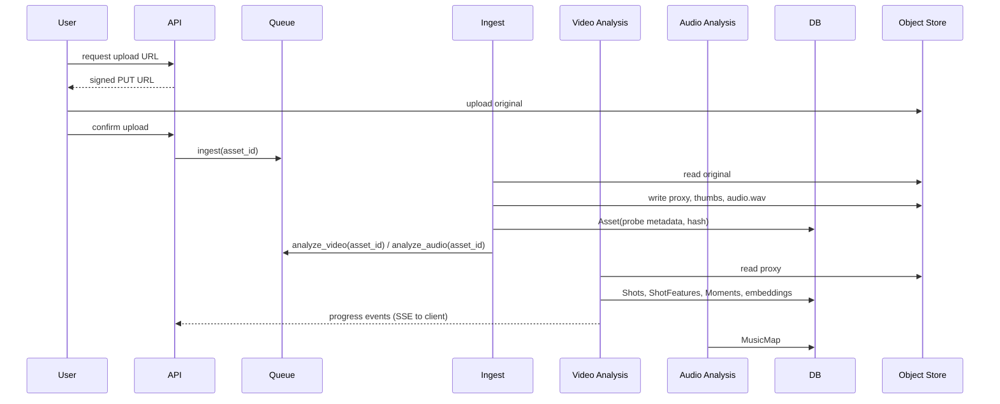

# AI Video Editing Agent: System Architecture

Version 0.1, 2026-09-05. Status: aspirational target design; not a description of the implemented repository.

> **2026-10-10 revision notice.** The product is now fully offline and
> independent: no external AI APIs, no cloud services (`OFFLINE_POLICY.md`,
> binding). Every mention below of hosted models (Claude, Haiku, GPT,
> Gemini, NVIDIA NIM hosted, hosted VLMs or STT), LiteLLM, Clerk/Auth.js,
> S3/R2/MinIO, or per-token costs is **superseded**. The Director and
> Reviser roles are implemented by the rule-based `LOCAL_DIRECTOR.md`;
> rendering details are in `RENDER_SPEC.md`; the verdicts in
> `ARCHITECTURE_REVIEW.md` override the original technology choices
> (madmom, InsightFace, SigLIP+LAION, TransNetV2-first, Next.js, Remotion).
> Sections that are superseded carry a short marker. The original text is
> kept for history.

This document defines the product and the architecture for an autonomous, natural-language-driven video editing agent. It is written to be handed to engineers as the reference before any code is written. Sections follow the 21 questions in the original brief, preceded by a problem analysis that motivates every technology choice.

---

## 0. Executive summary and the key architectural decisions

Ten decisions shape everything else. If you agree with these, the rest of the document follows.

| # | Decision | Why |
|---|----------|-----|
| 0 | **Fully offline and independent (added 2026-10-10).** No external AI API or cloud service at runtime; all intelligence is deterministic code, rule tables, or local model files run in-process. | Product requirement: privacy, zero running cost, works without internet. See `OFFLINE_POLICY.md`. Overrides decisions 8 and 10 where they name hosted providers. |
| 1 | **LLMs never touch pixels or audio samples.** They reason over compact symbolic descriptions produced by deterministic perception, and emit structured edits. | Keeps token cost tiny, makes the reasoning model swappable, and keeps output verifiable. |
| 2 | **The Timeline Document is the single source of truth.** Every generation and revision is an operation on a versioned JSON timeline. Video files are derived artifacts. | Enables "modify, don't regenerate", undo, diffing, partial re-rendering, and a future manual editor. |
| 3 | **Three-layer architecture: Perceive, Decide, Execute**, connected only through typed data contracts. | Each layer scales, caches, and evolves independently. Layer 2 (models) is the only layer that will churn. |
| 4 | **Hybrid decision making.** The LLM plans structure, taste, and constraints. A deterministic optimizer picks the exact clips and cut frames. | LLMs are poor at precise arithmetic over hundreds of candidate segments and cannot be trusted to respect a beat grid to the frame. Solvers can. |
| 5 | **Perception runs once per asset and is cached forever.** Analysis is keyed by content hash, never by project. | Footage analysis is the dominant compute cost. Re-analysis on every revision would make the product unaffordable. |
| 6 | **Two-tier rendering: cheap proxy previews, expensive finals.** Revisions re-render only the changed segments. | The revision loop must feel conversational (seconds), not batch (minutes). |
| 7 | **Music defines the grid.** Beats, bars, sections, and energy produce a "cut grid" that every edit decision snaps to. | Musical sync is the single biggest perceived-quality factor in short-form edits and it is fully computable. |
| 8 | **Model roles behind interfaces, wired by config.** Director, Reviser, Describer, Embedder, Beat Analyzer, Renderer are each an interface with pluggable providers. | Explicit requirement. Also, the model landscape changes every quarter. |
| 9 | **Revisions are compiled to a small operation grammar, validated, then applied.** The model proposes operations; code validates and applies them. | Prevents hallucinated clip IDs, timeline gaps, and silent regressions. |
| 10 | **Python for the AI/media backend, TypeScript for UI and motion graphics, FFmpeg for all pixel work.** | Every serious CV and audio library is Python-first. Remotion and the web UI are TypeScript-native. FFmpeg is the only renderer that is free, fast, and universal. |

---

## 1. Problem architecture (read before the technology sections)

### 1.1 What kind of problem this is

Automatic editing is often framed as a generation problem ("generate a video"). It is not. It is a **constrained selection and arrangement problem with a subjective objective function**, followed by a **deterministic compilation problem**.

Given:

- A pool of source segments S (thousands of candidate sub-clips of raw footage, each with measurable properties).
- A music track M that induces a time grid G (beats, bars, sections) and an energy curve E(t).
- A creative brief B in natural language.

Produce a timeline T: an ordered assignment of segments to grid slots, with per-slot parameters (speed, transition, effects, overlays), such that:

1. Hard constraints hold (target duration, no gaps, cuts on grid points, source bounds respected).
2. A soft objective is maximized (matches the brief's mood and structure, visual quality, variety, continuity, rhythm).

Then compile T into pixels.

This framing tells us where each kind of technology belongs:

- **Measuring properties of segments** is a perception problem. Computer vision and audio DSP. Deterministic, cacheable, embarrassingly parallel.
- **Translating the brief into constraints and weights** is a language understanding problem. This is where the LLM is irreplaceable.
- **Finding a good T under constraints** is an optimization problem. Search and scoring, optionally guided by the LLM for top-level structure and for tie-breaking on taste.
- **Compiling T into pixels** is a rendering problem. FFmpeg and a graphics engine. Deterministic and cacheable.
- **Revising T from a sentence** is a program-editing problem. Parse intent, resolve references ("the transition at the drop"), emit operations, validate, apply.

### 1.2 The three hard sub-problems

**Perception: turning pixels into facts.** Raw footage of arbitrary length must be reduced to a searchable index of shots with properties an editor cares about: shot scale (close-up, medium, wide), subject (who or what), motion energy, camera movement, stability, exposure, aesthetic quality, faces and their expressions, and a semantic description. The index must be compact enough that an LLM can read a summary of hours of footage in a few thousand tokens.

**Taste: mapping intent to decisions.** "Cinematic but energetic, build anticipation, faster after the drop, more close-ups, minimal transitions" must become numbers: a pacing curve over time, shot-scale preferences per section, a transition budget, a color grade, speed-ramp policy. This is language work, and it is also where the product's quality ceiling lives.

**Revision: editing state, not regenerating it.** Users think in terms of the video they just watched. "The first five seconds" and "the transition at the beat drop" are references into the current timeline. The system must resolve them, change exactly what was asked, keep everything else stable, and re-render only what changed.

### 1.3 Why the timeline is the center of the architecture

Every component either produces inputs to the timeline (perception, music analysis, brief parsing), produces the timeline (the agent), consumes the timeline (renderer, UI), or transforms it (revision). Making the timeline an explicit, versioned, schema-validated document is what makes the system:

- **Revisable**: operations on a document instead of regeneration.
- **Inspectable**: the UI can show what the AI decided and why.
- **Cacheable**: render segments are keyed by clip spec hash.
- **Model-agnostic**: any model that can emit valid JSON against the schema can drive it.
- **Future-proof**: a manual timeline editor later is just another operation producer.

---

## 2. Product definition

**Name (working):** Cutline Agent. (Placeholder, rename freely.)

**One sentence:** An AI editing agent that turns raw footage, a music track, and a sentence of creative direction into a beat-synced edit, then keeps revising it in conversation until the creator is happy.

**Who it is for (initial):** Creators, small brands, and agencies producing short-form vertical or horizontal content (reels, shorts, promos, event recaps, travel and sports highlights) from their own footage. They have taste but not time. They are not colorists or motion designers.

**What it is not:** Not a template tool. Not a timeline-first NLE with an AI button. Not a text-to-video generator. The user's footage is always the material; the AI is the editor, not the cinematographer.

**Core value proposition:**

1. Zero-to-first-cut in minutes from hours of footage.
2. Musically tight edits by construction.
3. Revision by conversation, with the previous cut preserved and the change explained.
4. Full editability: the result is a real timeline, exportable to professional tools later.

**Primary user journey:**

1. Create a project, set target format (duration, aspect ratio).
2. Upload footage (one or many files, any length). Analysis runs in the background with progress.
3. Upload or pick music. Analysis runs.
4. Write the brief. Optionally answer two or three clarifying questions the agent asks.
5. Receive a preview cut plus an "editor's notes" summary of what it did and why.
6. Iterate in chat. Each turn produces a new version, a diff summary, and an updated preview.
7. Export final render, and optionally the timeline (OTIO, FCPXML, EDL) for a pro tool.

**Success metrics (product):** time to first accepted cut, number of revision turns to acceptance, revision precision (did the change do only what was asked), export rate, retention.

---

## 3. Functional requirements

Grouped by capability. "M" = MVP, "L" = later.

### 3.1 Ingest and asset management
- FR-1 (M) Upload multiple video files, any duration, common containers and codecs (MP4/MOV/MKV, H.264/H.265/ProRes), variable frame rates.
- FR-2 (M) Upload audio (MP3/WAV/M4A/FLAC) or pick from a licensed library (L).
- FR-3 (M) Generate proxies (low-res transcodes) and thumbnails for every asset.
- FR-4 (M) Deduplicate by content hash; reuse prior analysis.
- FR-5 (L) Import from cloud drives and phones; folder watch.

### 3.2 Video understanding
- FR-6 (M) Shot boundary detection (hard cuts and gradual transitions in source).
- FR-7 (M) Per-shot metrics: duration, motion magnitude and direction, camera motion type (static, pan, tilt, handheld, tracking), stability, exposure and sharpness quality.
- FR-8 (M) Shot scale classification (extreme close-up through wide).
- FR-9 (M) Face detection and count; face size relative to frame; (L) identity clustering so "the woman in red" or "person A" is resolvable.
- FR-10 (M) Object and scene detection (people, vehicles, animals, food, landscapes, indoors/outdoors).
- FR-11 (M) Semantic description and embedding for each shot (searchable by text).
- FR-12 (M) Highlight scoring: candidate "hero moments" per shot (peaks of motion, emotion, aesthetics).
- FR-13 (M) Slow versus fast movement segmentation within a shot (motion curve, not one number per shot).
- FR-14 (L) Speech transcription in footage with word timestamps; speaker diarization.
- FR-15 (L) Action recognition (jump, wave, laugh, pour, kick).

### 3.3 Audio and music understanding
- FR-16 (M) BPM, beat and downbeat positions, time signature estimate.
- FR-17 (M) Structural segmentation (intro, build, drop, verse, chorus, breakdown, outro).
- FR-18 (M) Energy curve (loudness plus spectral flux), onsets, and beat-drop detection.
- FR-19 (M) Best-window selection: which N seconds of a longer track to use for a target duration.
- FR-20 (L) Stem separation for ducking and sound design; (L) vocal detection for caption placement.
- FR-21 (L) Footage audio analysis: speech presence, applause, laughter, silence, wind noise.

### 3.4 Creative brief understanding
- FR-22 (M) Parse free-text brief into a structured Creative Brief (duration, aspect, mood, pacing curve, shot-scale preferences, transition policy, caption needs, must-include and must-exclude content, story arc).
- FR-23 (M) Ask up to three clarifying questions when the brief is ambiguous on a high-impact axis; proceed with stated defaults otherwise. *(Superseded by review item 20: ask only when duration or aspect is missing; see `LOCAL_DIRECTOR.md` Section 3.)*
- FR-24 (L) Style presets and reference videos ("edit like this").

### 3.5 Editing
- FR-25 (M) Produce a complete timeline: music window, sections, clips with in/out points, speed, transitions, basic color grade, captions if requested.
- FR-26 (M) Cuts snap to the music grid with configurable tolerance; cut density follows the pacing curve.
- FR-27 (M) Speed ramps and slow motion aligned to motion peaks and beats.
- FR-28 (M) Transition selection under a budget (cut, crossfade, dip, whip, zoom, flash).
- FR-29 (M) Variety and continuity rules: no immediate reuse of the same shot, avoid jump cuts from the same setup, distribute coverage across sources when a story arc is requested.
- FR-30 (M) Editor's notes: human-readable rationale for the structure and key choices.
- FR-31 (L) Motion graphics, kinetic captions, lower thirds, logo stings via programmatic templates.
- FR-32 (L) Auto reframing for aspect ratio changes (subject tracking crop).
- FR-33 (L) Sound design: whooshes on whips, impacts on drops, ducking under speech.

### 3.6 Natural language revision
- FR-34 (M) Accept a revision instruction and produce a new timeline version that changes only what was asked.
- FR-35 (M) Resolve temporal references ("first five seconds", "at 0:23", "the ending"), musical references ("at the drop", "second chorus"), structural references ("the third clip", "this section" via UI selection), and content references ("the shot of the dog").
- FR-36 (M) Support operation classes: retime, replace clip, add or remove transition, change transition type, change speed, change section pacing, regenerate a section with new intent, change color grade, add or edit captions, reorder, trim, change music window.
- FR-37 (M) Explain every change as a diff in plain language; allow revert to any prior version.
- FR-38 (M) Ask for clarification when a reference is ambiguous, showing candidates with thumbnails.
- FR-39 (L) Multi-step revisions in one instruction; conditional instructions ("if there is a better close-up, use it").

### 3.7 Rendering and export
- FR-40 (M) Fast preview render (proxy resolution) after every version.
- FR-41 (M) Final render at 1080p, (L) 4K, with correct frame rate and color handling.
- FR-42 (M) Partial re-render: only segments affected by a revision.
- FR-43 (L) Export timeline to OpenTimelineIO, FCPXML, Premiere XML, DaVinci Resolve.
- FR-44 (L) Burned-in versus sidecar captions; platform presets (Reels, TikTok, YouTube).

### 3.8 Collaboration and project management
- FR-45 (M) Projects, versions, and version history with thumbnails.
- FR-46 (L) Comments, sharing links, team workspaces, brand kits.

---

## 4. Non-functional requirements

| Area | Requirement | Rationale |
|------|-------------|-----------|
| **Latency (revision)** | Small revisions produce a new preview in under 15 s at p50, under 45 s at p95. | The revision loop must feel conversational. Drives partial rendering and cheap-model routing. |
| **Latency (first cut)** | For 30 min of footage already analyzed, first preview in under 2 min. | Analysis is asynchronous and shown as progress; generation must not be. |
| **Throughput (analysis)** | Analyze footage at 3x to 10x real time per worker on a mid-range GPU; CPU fallback at 0.5x to 1x. | Dictates worker sizing and the two-pass (cheap first, deep later) analysis design. |
| **Determinism** | Same timeline version always renders to the same output. Perception outputs are deterministic given model version. | Required for caching, debugging, and user trust. LLM calls are the only non-deterministic step and are recorded. |
| **Model replaceability** | Any model role can be swapped by configuration with zero code changes in other components. Every model call is logged with provider, model, version, prompt hash, and cost. | Explicit requirement. |
| **Cost ceiling** | Target marginal cost per finished 60 s edit (including two to five revisions) under USD 1.50 at scale, dominated by compute, not tokens. | Determines pricing viability. See Section 21. |
| **Scalability** | Stateless API; horizontally scalable workers per queue type (CPU analysis, GPU analysis, render); object storage for all media. | Standard cloud scaling; no shared local disk assumptions. |
| **Reliability** | All long jobs idempotent and resumable at the step level; retries with backoff; no job loses user data. | Media jobs fail for boring reasons (codec quirks, OOM). |
| **Observability** | Traces across API, queue, workers, and model calls; per-project cost accounting; quality telemetry (revision count, revert rate). | Cost and quality are both invisible without it. |
| **Security and privacy** | Footage is private by default, encrypted at rest, signed URLs with short TTL, per-tenant isolation in storage paths and DB rows. Option to disable sending frames to third-party model APIs (local-only perception mode). | User footage may contain faces and minors. Some customers will require no-egress. |
| **Portability** | Runs on a single developer machine with Docker Compose (Postgres, Redis, MinIO, workers) and on Kubernetes without code change. | Solo or small-team development must be possible. |
| **Extensibility** | New effects, transitions, and analyzers are plugins registering a schema and an implementation. | Effects will be added continuously. |
| **Accuracy** | Cut placement within one frame of the intended grid point. Audio/video sync within 10 ms. | Off-beat cuts are immediately noticeable. |

---

## 5. Complete system architecture

### 5.1 Layered view



> **Superseded (2026-10-10):** the API gateway, auth, queues, Redis, object
> storage, and Remotion boxes above describe a hosted service. The offline
> product is: local UI (loopback only) → local Python API → one worker
> process → local files/SQLite. The Decision layer's "Model Gateway" loads
> only registered local models (`OFFLINE_POLICY.md` Section 4).

### 5.2 Local project storage (current P2.3 slice)

The current local project library stores a serializable `project.json` in
the chosen project root. It contains the project ID, stable asset IDs,
SHA-256 content hashes, media metadata, absolute current source paths, and
the optional editor timeline. Original media remains external and is never
modified or copied by import. Backups must include `project.json` and all
referenced media; restoring elsewhere requires relinking each moved source.
Relinking checks the original content hash and preserves the stable asset ID.
This is a local-file manifest, not the future database/object-store design
described below. Import supports video, image, audio, and music metadata;
this does not imply the renderer supports those media kinds yet.

### 5.3 Deployment view

> **Superseded (2026-10-10):** hosted deployment is out of scope. The
> current deployment is a single local machine; see `OFFLINE_POLICY.md`.

- **Web app**: Next.js, served statically or via Node. Talks only to the API.
- **API service**: stateless FastAPI containers behind a load balancer. Owns auth, project CRUD, job submission, timeline reads, event streaming.
- **Workers**: separate deployables per queue so they scale independently:
  - `worker-cpu`: ingest, proxies, thumbnails, audio analysis, shot detection, timeline compile, FFmpeg segment rendering.
  - `worker-gpu`: detection, embeddings, VLM describer (if local), optical flow, transcription.
  - `worker-agent`: LLM-orchestrated steps (brief parsing, direction, revision, critique). Low CPU, high I/O wait.
  - `worker-gfx`: Node process running Remotion for graphics layers.
- **Data**: Postgres (metadata, timelines, index tables with pgvector), Redis (queues, pub/sub for progress, short-lived cache), S3-compatible object storage (MinIO locally).
- **Dev mode**: one Docker Compose file starts everything; workers can run as a single process with all queues for a laptop.

---

## 6. Components and responsibilities

| Component | Responsibility | Inputs | Outputs | Does NOT do |
|-----------|----------------|--------|---------|-------------|
| **Ingest Service** | Probe media, normalize metadata, compute content hash, generate proxies (540p H.264, constant frame rate), thumbnails, waveform peaks, extract audio track. | Uploaded file | `Asset` record, proxy, thumbs, audio WAV | Any semantic analysis |
| **Video Analysis Pipeline** | Run the multi-stage analyzers (Section 9) and write the Footage Index. | Asset proxy + original | `Shot`, `ShotFeature`, `Moment`, embeddings | Decide what is "good for this edit" (that is context-dependent and belongs to the agent) |
| **Audio Analysis Pipeline** | Beat, downbeat, structure, energy, drop detection; music window candidates. | Audio asset | `MusicMap` | Mixing or rendering |
| **Footage Index** | Query layer over analysis results: filter by tags, scale, motion, faces; semantic search by text; compact summaries for LLM consumption. | Queries | Ranked shot lists, summaries | Store pixels |
| **Brief Parser** | Turn free text into a `CreativeBrief` JSON; detect ambiguity; generate clarifying questions. | Brief text, project settings, footage summary | `CreativeBrief`, questions | Choose clips |
| **Editing Director** | Produce the `EditPlan`: music window, section structure mapped to music structure, per-section pacing and shot-mix targets, transition budget, style parameters, caption plan. Writes editor's notes. | `CreativeBrief`, `MusicMap`, Footage Index summary | `EditPlan` | Pick exact frames |
| **Clip Selection Optimizer (Cutter)** | Fill the cut grid with concrete clips maximizing a scoring function derived from the plan, under hard constraints. Assign speed ramps and transitions per policy. | `EditPlan`, `MusicMap`, Footage Index | Draft `Timeline` | Interpret language |
| **Self-Critique** | Evaluate a draft against the brief using a contact sheet and timeline statistics; propose bounded fixes. | Draft timeline, preview stills | Critique report, fix operations | Unbounded loops |
| **Revision Engine** | Classify instruction, resolve references, emit validated operations, produce diff summary. | Instruction, current timeline, conversation context, UI selection | New timeline version + explanation | Regenerate the whole edit unless asked |
| **Timeline Service** | Store versions, validate schema and invariants, apply operations, compute diffs, compute which segments changed. | Operations | Versions, diffs, dirty ranges | Render |
| **Timeline Compiler** | Translate a timeline into a render graph: per-segment FFmpeg filter specs, graphics jobs, audio mix spec. | Timeline version | `RenderGraph` | Execute |
| **Segment Renderer** | Render each video segment (trim, retime, transform, color) to an intermediate file, keyed by spec hash. | `RenderGraph` segments | Segment files | Assembly |
| **Graphics Renderer** | Render caption and motion-graphics layers to transparent video or image sequences. | Graphics track items | Overlay files | Video cutting |
| **Assembler** | Concatenate segments with transitions, overlay graphics, mix audio, mux, produce preview or final. | Segments, overlays, audio spec | Output file, thumbnails | Analysis |
| **Model Gateway** | Uniform interface to LLMs, VLMs, embedding models; routing by role; structured output enforcement; retries; cost and latency logging; caching of identical calls. | Role + request | Typed response | Business logic |
| **Workflow Engine** | Define and run multi-step jobs with retries, resumption, fan-out, and progress events. | Job definitions | Job state, events | Domain logic |
| **API Gateway** | Auth, REST, event streaming, upload URLs. | HTTP | JSON, SSE | Heavy compute |
| **Web Client** | Upload, chat, timeline visualization, preview playback, version history, clarification UI. | API | User interaction | Rendering |

---

## 7. Data flow between components

### 7.1 Ingest and analysis (per asset, once)



Analysis results are keyed by `content_hash + analyzer_name + analyzer_version`. Uploading the same file again, in any project, is free.

### 7.2 Generation (per project, on "create")

```
CreativeBrief text ──► Brief Parser ──► CreativeBrief JSON ──┐
MusicMap ────────────────────────────────────────────────────┤
Footage Index summary (compact, ~2-6k tokens) ───────────────┤
                                                              ▼
                                                    Editing Director
                                                              │ EditPlan JSON
                                                              ▼
MusicMap + Footage Index (full query access) ──► Clip Selection Optimizer
                                                              │ Draft Timeline
                                                              ▼
                                                     Validator ──fail──► repair loop (bounded)
                                                              │
                                                              ▼
                                                    Self-Critique (optional, 1 pass)
                                                              │ fix ops
                                                              ▼
                                                 Timeline Service: save v1
                                                              │
                                                              ▼
                                       Compiler ──► Segment Renderer ──► Assembler ──► preview.mp4
                                                              │
                                                              ▼
                                            Client: preview + editor's notes + timeline view
```

### 7.3 Revision (per chat turn)

```
Instruction + UI selection + current timeline vN + conversation summary
        │
        ▼
Intent Classifier (cheap model) ─► {local_edit | section_regen | global_style | question | ambiguous}
        │
        ▼
Reference Resolver (code + cheap model) ─► concrete targets (clip ids, time ranges, markers)
        │                                      └─ ambiguous ──► clarifying question with candidates
        ▼
Operation Generator (cheap model, schema-constrained; escalates to Director for section_regen)
        │ List[Operation]
        ▼
Dry-run apply + Validator ─► reject/repair ─► apply ─► vN+1 + Diff
        │
        ▼
Dirty-range computation ─► partial re-render ─► preview vN+1
        │
        ▼
Reply: plain-language diff + preview + "revert" affordance
```

---

## 8. AI model responsibilities

### 8.1 Roles

> **Superseded (2026-10-10).** Offline role assignment, which replaces the
> table below:
>
> | Role | Offline implementation | Status |
> |------|------------------------|--------|
> | Director (brief → plan) | Rule-based Local Director + style lexicon (`LOCAL_DIRECTOR.md`); optional in-process llama.cpp model later | Design |
> | Reviser (instruction → operations) | Same engine, revision intents | Design |
> | Describer (VLM) | Deferred (review item 14); local model only if P7 justifies it | Not planned yet |
> | Embedder | Deferred; local OpenCLIP ViT-L/14 file if semantic search is needed (review item 13) | Not planned yet |
> | Detector (faces) | OpenCV YuNet ONNX, Apache 2.0 (review item 16) | First P1 iteration |
> | Beat analyzer | librosa (implemented); allin1 (MIT) only if librosa fails the beat-flash check | Implemented |
> | Structure analyzer | librosa novelty; allin1 optional | Deferred |
> | Transcriber | whisper.cpp / faster-whisper with a local model file | P6 |
> | Critic | Deferred (review item 22) | — |

Each role is an interface. Concrete providers are chosen in a routing config, per environment, per tenant, or per request.

| Role | Task | Frequency | Quality need | Default provider | Alternatives |
|------|------|-----------|--------------|------------------|--------------|
| **Director** | Brief parsing, edit planning, section regeneration, self-critique, editor's notes | 1 to 3 calls per generation; rare in revision | Highest reasoning, long context, reliable JSON | Claude Opus 5 (`claude-opus-5`), adaptive thinking, effort `high` | Claude Fable 5.1 for hardest briefs; GPT-5 class; Gemini 2.5 Pro class; Qwen3 or DeepSeek via NVIDIA NIM for self-hosting |
| **Reviser** | Intent classification, reference resolution assist, operation generation for routine edits | Every chat turn | Fast, cheap, reliable JSON, modest reasoning | Claude Haiku 4.5 (`claude-haiku-4-5`) or Claude Sonnet 5 at effort `low` | GPT-5-mini class; Gemini Flash class; Llama or Qwen 8B to 32B via NVIDIA NIM or vLLM |
| **Describer (VLM)** | Semantic caption, mood, subject, action, shot-scale sanity check from keyframes or short proxy clips | Once per shot | Vision grounding, cheap at scale | Local Qwen2.5-VL 7B or Florence-2 for no-egress; Claude Haiku 4.5 or Gemini Flash class with image input for hosted | Whole-video input models (Gemini) as a single-pass alternative for short assets |
| **Embedder** | Text-image joint embeddings for semantic search over shots | Once per shot; once per query | Retrieval quality | Local SigLIP 2 or OpenCLIP ViT-L | Cloud multimodal embeddings |
| **Detector** | Objects, people, faces, poses | Sampled frames | Speed | RT-DETR or YOLO-family (check license), InsightFace SCRFD for faces | MediaPipe for CPU-only |
| **Beat Analyzer** | Beats, downbeats, tempo | Once per track | Accuracy on downbeats | madmom (RNN downbeat tracker) with librosa fallback | Essentia; BeatNet; allin1 |
| **Structure Analyzer** | Song sections and boundaries | Once per track | Boundary accuracy | allin1 (All-In-One) | Novelty-based segmentation on self-similarity matrix (librosa) |
| **Transcriber** | Speech to text in footage (later) | Once per asset | Word timestamps | faster-whisper | Cloud STT |
| **Critic (VLM)** | Judge a contact sheet or preview against the brief (optional) | 0 to 1 per generation | Vision plus reasoning | Same as Director with images | Skip in MVP |

### 8.2 Rules for using models

> Rules 2, 3 and 4 still apply to the local engine. Rules 5 and 7 (provider
> caching and vendor fallbacks) do not apply offline; "fallback" now means
> falling back from an optional local model to the rule engine.

1. **Structured output always.** Every LLM call returns JSON validated against a schema (Pydantic). Use the provider's native structured output where available (for Claude, `output_config.format`; strict tools where a tool call is more natural). Free text is only allowed inside designated fields such as `rationale`.
2. **No pixels in the Director's context.** The Director sees the Footage Index summary and MusicMap summary, never frames, except in the optional Critic pass.
3. **IDs, not descriptions, in outputs.** Models refer to shots, clips, sections, and markers by ID. The validator rejects unknown IDs. This kills the most common hallucination class.
4. **Bounded loops.** Repair and critique loops have a hard iteration cap (2). Beyond that, return the best valid result with a note.
5. **Cache aggressively.** Stable system prompts and schemas first in the prompt, volatile content last, so provider prompt caching hits. Identical call payloads are memoized.
6. **Record everything.** Provider, model, version, prompt hash, token counts, latency, cost, and the parsed output are stored per call and linked to the timeline version they produced. This is what makes A/B testing of models possible later.
7. **Fallbacks by role.** If the primary provider fails or refuses, route to the configured secondary. Never fail a job because one vendor is down.

---

## 9. Video analysis pipeline

Design principle: **cheap passes first, expensive passes on candidates only.** A 60-minute source may contain 600 shots; only a fraction will be hero candidates worth a VLM call.

> **Review overrides:** primary segmentation is motion-curve windows, not
> TransNetV2 (item 11); proxies are 720p, not 540p (item 17); faces use
> YuNet, not SCRFD (item 16); shot scale for non-person footage needs CLIP
> zero-shot (item 12); the LAION aesthetic head requires OpenCLIP
> ViT-L/14, not SigLIP (item 13); VLM and RT-DETR are deferred (items 14,
> 15). Hosted VLM options in stage 7 are removed by `OFFLINE_POLICY.md`.

### 9.1 Stages

```
Original ─► [0] Probe & Proxy ─► [1] Shot Detection ─► [2] Per-shot cheap metrics
          ─► [3] Keyframe selection ─► [4] Detection (faces, objects, pose)
          ─► [5] Shot scale & framing ─► [6] Embeddings ─► [7] VLM description
          ─► [8] Moment scoring ─► [9] Footage Index write
```

| Stage | Method | Runs on | Output |
|-------|--------|---------|--------|
| **0 Probe & Proxy** | ffprobe; ffmpeg transcode to 540p CFR H.264 at 24 or 30 fps; extract audio to 16 kHz mono WAV; sprite sheets for scrubbing | CPU | Asset metadata, proxy, audio |
| **1 Shot detection** | TransNetV2 (learned, robust to gradual transitions) on the proxy; PySceneDetect content detector as CPU fallback. Minimum shot length 0.4 s; very long static shots are additionally split into 4 to 8 s "sub-shots" so long takes are selectable in pieces. | GPU or CPU | `Shot(asset_id, start_ms, end_ms, kind)` |
| **2 Cheap per-shot metrics** | Dense optical flow (OpenCV Farneback or RAFT-small) at 4 to 8 fps sampled: motion magnitude curve, dominant direction, camera-motion class (static, pan, tilt, zoom, handheld, tracking) from global versus local flow; stability (jitter energy); sharpness (Laplacian variance); exposure histogram (clipping %, mean luma); color stats (dominant hues, saturation, warmth) | CPU | `ShotFeature` numeric fields plus `motion_curve[]` |
| **3 Keyframe selection** | 3 to 5 frames per shot at motion-curve peaks, valleys, and the median, deduplicated by perceptual hash | CPU | Keyframe JPEGs |
| **4 Detection** | Faces (SCRFD) with bounding boxes, landmarks, optional embeddings for identity clustering; objects (RT-DETR) with COCO plus a small custom label set; person pose keypoints for action cues (later) | GPU | Boxes, counts, per-frame |
| **5 Shot scale and framing** | Rule-based from largest face or person box height relative to frame: ECU, CU, MCU, MS, MLS, LS, WS. Subject position (rule-of-thirds bucket). Confirmed or overridden by VLM in stage 7 when confidence is low. | CPU | `scale`, `framing` |
| **6 Embeddings** | SigLIP image embedding per keyframe, mean-pooled per shot; stored in pgvector. Enables "shot of the dog running" queries and mood similarity. | GPU | `embedding[768]` |
| **7 VLM description** | For each shot, or for the top 40% by preliminary interest score when budget-limited: given 3 keyframes plus numeric hints, return a structured description: subjects, action, setting, mood tags, shot-scale confirmation, notable details, and a one-line caption. Strict JSON. | GPU (local) or API | `ShotSemantics` |
| **8 Moment scoring** | Within each shot, locate `Moment`s: windows of 0.5 to 4 s at motion peaks, at facial-expression changes, at aesthetic peaks. Each gets a generic `interest` score (0 to 1) from a weighted combination of motion peakiness, sharpness, face presence and size, and aesthetic predictor (LAION aesthetic head on the SigLIP embedding). This score is brief-independent; the agent re-weights it per brief. | CPU | `Moment(shot_id, start_ms, end_ms, interest, tags)` |
| **9 Index write** | Persist; build the compact LLM summary (Section 9.3). | CPU | Footage Index |

### 9.2 Feature schema per shot (abbreviated)

```json
{
  "shot_id": "a1_s017",
  "asset_id": "a1",
  "start_ms": 34120, "end_ms": 41800, "duration_ms": 7680,
  "scale": "CU", "scale_confidence": 0.82,
  "camera_motion": "handheld_tracking",
  "motion": {"mean": 0.42, "peak": 0.91, "peak_at_ms": 37400, "curve_hz": 4, "curve": [0.1, 0.2]},
  "stability": 0.63, "sharpness": 0.78, "exposure_quality": 0.9,
  "faces": {"count": 1, "max_rel_height": 0.46, "identities": ["p1"]},
  "objects": ["person", "skateboard"],
  "semantics": {
    "caption": "Skater lands a kickflip, camera follows low and close, golden hour",
    "subjects": ["skater"], "action": "landing a trick", "setting": "outdoor skatepark, sunset",
    "mood": ["energetic", "triumphant", "warm"]
  },
  "color": {"warmth": 0.7, "saturation": 0.6, "dominant": ["orange", "teal"]},
  "moments": [{"start_ms": 36800, "end_ms": 38200, "interest": 0.93, "tags": ["motion_peak", "face"]}],
  "embedding_ref": "vec:a1_s017"
}
```

### 9.3 The compact summary for the Director

The Director cannot read thousands of shots. The Footage Index produces a **summary under a token budget** (default 4k tokens):

- Per asset: duration, setting summary, subjects, overall mood, coverage (how many CU/MS/WS shots, motion distribution).
- Top N moments overall (N about 40 to 80) with one-line captions, scale, motion, duration, and IDs.
- Clusters: shots grouped by subject and setting so the Director can reason about "the beach footage" versus "the dinner footage".

The Director plans against this summary. The Cutter then queries the full index programmatically. This division is what keeps token costs flat as footage grows.

---

## 10. Audio analysis pipeline

### 10.1 Music track

> **Review override (item 7):** madmom is replaced (unmaintained; models are
> non-commercial). v0 uses librosa beats and per-beat energy only, with no
> assumed downbeats (`MVP.md` Section 7).

| Stage | Method | Output |
|-------|--------|--------|
| Decode and normalize | ffmpeg to 44.1 kHz mono float; loudness measurement (EBU R128) | Normalized audio, integrated loudness |
| Tempo, beats, downbeats | madmom RNN beat and downbeat tracker (state of the art for downbeats), librosa beat tracker as cross-check; resolve to a stable BPM and a beat grid with per-beat timestamps and bar positions | `bpm`, `beats[] {t_ms, bar, beat_in_bar, strength}` |
| Onsets and transients | Spectral flux onset detection; separate percussive onsets via HPSS | `onsets[]` for sub-beat sync of whips and flashes |
| Energy curve | Frame-level RMS plus spectral flux plus low-band energy, smoothed at two scales (0.5 s and 4 s), normalized 0 to 1 | `energy[] at 10 Hz` |
| Structure | allin1 for section labels (intro, verse, chorus, bridge, outro) and boundaries; fallback: novelty peaks on a self-similarity matrix of chroma plus MFCC | `sections[] {start_ms, end_ms, label, energy_mean}` |
| Drop detection | Heuristic on top of structure and energy: a boundary where 4-s energy rises by more than a threshold within one bar, low-band energy jumps, and the preceding 4 to 8 bars show rising or thinning texture (build). Ranked list, not a single answer. | `drops[] {t_ms, confidence, build_start_ms}` |
| Cut grid derivation | For each section, produce allowed cut points at bar, beat, half-beat, and onset granularity, tagged by strength. The agent picks a granularity per section from the pacing curve. | `grid[] {t_ms, level: bar|beat|half|onset, strength}` |
| Window candidates | For target duration D, slide over the track and score windows by: contains a drop at 45% to 65% of D (if the brief wants a build), starts on a bar, ends on a section boundary or with a natural decay, average energy matches brief mood. Return top 3. | `windows[] {in_ms, out_ms, score, features}` |

### 10.2 Footage audio (later phase)

Speech presence and transcript (faster-whisper), applause and laughter detection (audio event classifier such as PANNs or YAMNet), silence and wind noise. Used to protect dialogue from cuts, to caption, and to score "moments" (a crowd cheering is a highlight signal).

### 10.3 MusicMap summary for the Director

Under 800 tokens: BPM, duration, sections with labels and energy, ranked drops, and the three window candidates. The Director selects a window and a per-section pacing plan against this.

---

## 11. AI editing agent workflow

> **2026-10-10:** in the offline product every "Director" / "Reviser" step
> below is performed by the rule-based `LOCAL_DIRECTOR.md`. Steps 1 and 3
> are merged into one call (review item 21), clarifying questions are
> limited to missing duration or aspect (item 20), and Step 6 self-critique
> is deferred (item 22). The beam search in Step 4 starts as greedy with
> one-step lookahead (item 4).

The agent is a **workflow with LLM steps**, not an open-ended autonomous loop. Every step has a typed input, a typed output, and a validator. This is deliberate: it makes cost bounded, behavior debuggable, and quality measurable per step.

### 11.1 Step by step

**Step 1: Brief parsing (Director or Reviser model).**
Input: brief text, project settings, footage summary (so the model can reason about feasibility), MusicMap summary.
Output: `CreativeBrief`:

```json
{
  "target_duration_ms": 60000, "aspect": "9:16",
  "mood": ["cinematic", "energetic"], "intensity_arc": "slow_build_then_fast",
  "pacing": {"start": "slow", "after_drop": "fast", "explicit_points": []},
  "shot_preferences": {"scale_weights": {"CU": 1.6, "MS": 1.0, "WS": 0.7}, "motion_preference": "match_energy"},
  "transitions": {"policy": "minimal", "budget": 4, "allowed": ["cut", "crossfade", "whip"]},
  "captions": {"wanted": false},
  "must_include": [], "must_exclude": [],
  "story": {"type": "none|chronological|thematic", "notes": ""},
  "ambiguities": [{"axis": "subject_focus", "question": "Should the edit focus on one person or the group?", "impact": "high"}]
}
```

If any ambiguity has `impact: high`, the system asks (max three questions) and waits; otherwise it proceeds with defaults and notes them in the editor's notes.

**Step 2: Music window and grid selection (code, Director confirms).**
Code proposes window candidates from the MusicMap. The Director picks one and assigns the brief's arc to the music's sections, producing the `EditPlan.sections`.

**Step 3: Edit planning (Director).**
Output: `EditPlan`:

```json
{
  "music": {"asset_id": "m1", "in_ms": 12000, "out_ms": 72000},
  "sections": [
    {"id": "sec1", "tl_start_ms": 0, "tl_end_ms": 14200, "music_label": "intro",
     "intent": "establish place and anticipation; wide and slow",
     "cut_granularity": "bar", "target_cut_interval_ms": 2800,
     "scale_weights": {"WS": 1.5, "MS": 1.0, "CU": 0.8},
     "motion_target": "low", "speed_policy": "allow_slowmo", "transition_policy": "crossfade_ok",
     "content_hints": ["skatepark exterior", "skater preparing"]},
    {"id": "sec2", "tl_start_ms": 14200, "tl_end_ms": 31000, "music_label": "build"},
    {"id": "sec3", "tl_start_ms": 31000, "tl_end_ms": 52000, "music_label": "drop",
     "cut_granularity": "half_beat", "target_cut_interval_ms": 650,
     "scale_weights": {"CU": 1.8, "MS": 1.0, "WS": 0.4}, "motion_target": "high",
     "speed_policy": "ramps_on_peaks", "transition_policy": "cuts_only",
     "hit_on_drop": {"type": "flash_cut", "clip_hint": "hero moment"}}
  ],
  "style": {"grade": "cinematic_warm", "grade_intensity": 0.6, "letterbox": false},
  "global_rules": {"no_shot_reuse": true, "min_clip_ms": 350, "max_clip_ms": 5000},
  "editor_notes": "Opening on the wide sunset establishing shot to..."
}
```

**Step 4: Clip selection (Cutter, deterministic).**
For each section, generate slots from the cut grid at the section's granularity, adjusting to hit the target cut interval. Then fill slots:

```
Score(moment m, slot s) =
    w_rel     * semantic_relevance(m, section.content_hints, brief.mood)
  + w_scale   * scale_weights[m.scale]
  + w_motion  * motion_match(m.motion, section.motion_target, energy(s))
  + w_quality * quality(m.sharpness, m.exposure, m.stability, m.interest)
  + w_beat    * beat_alignment(m.motion_peak, s.strongest_beat)     # sections with ramps_on_peaks
  - w_repeat  * reuse_penalty(m.shot, recent_history)
  - w_jump    * jump_cut_penalty(m, previous_clip)                   # same setup and scale
  - w_cover   * coverage_imbalance(assets, story_type)
```

Solve with beam search (beam 8 to 16) per section, which keeps sequence-dependent penalties tractable. Clip in/out points are chosen so a motion peak (if any) lands on the slot's strongest beat, and so clip length equals the slot length divided by the chosen speed. Speed ramps are inserted where the policy allows and a motion peak exists: slow into the peak, snap to normal on the beat.

Transitions are assigned from the section policy and the global budget, prioritized at section boundaries and at the drop.

**Step 5: Validation and repair (code, then Reviser if needed).**
Invariants (Section 12.4). Violations are first fixed by deterministic repair (snap, trim, extend neighbor). Residual issues go to the Reviser model with the violation list, for at most two attempts.

**Step 6: Self-critique (Director, optional, one pass).**
Generate a contact sheet (one thumbnail per clip with timing) and timeline statistics (cut interval per section, scale distribution, transitions used, reuse count). Ask the Director: does this match the plan and brief? Output: list of operations or "accept". Apply through the standard operation path. MVP can ship without this step; it is a quality lever, not a dependency.

**Step 7: Persist and render.**
Save `Timeline v1` with provenance (all model calls, plan, brief). Render preview. Return editor's notes.

### 11.2 Why not a free-running tool-using agent?

A free agent that browses the footage index, tries cuts, renders, and looks at results is more flexible and far more expensive and slower (minutes and dollars per generation), with unbounded variance. The structured workflow above gets 90% of the value at 5% of the cost, and it produces the same `Timeline` artifact, so a free-agent mode can be added later as an alternative Director implementation for a premium tier without changing anything downstream.

---

## 12. Editable timeline architecture

### 12.1 Design goals

- Complete: everything needed to render, nothing that requires re-analysis.
- Semantic: retains *why* (section intents, clip rationale, tags) so revisions can reason.
- Diffable and versioned.
- Convertible to OpenTimelineIO for export (the schema is designed to map cleanly).

### 12.2 Schema (abbreviated, v1 target)

The repository's P2.1 `EditorTimeline` is a data-only first slice of this
target: stable project/timeline, asset, layer, track, and clip IDs; a rational
frame-rate plus integer tick time base; video/image/audio/music/text assets;
source and timeline ranges; transforms; audio settings; and typed allowlisted
transition/effect/animation references. It intentionally does not yet model
sections, speed ramps, arbitrary effect parameters, rendering, or operation
history. The legacy MVP `Timeline` v0.1 remains unchanged and is still the
contract consumed by the cutter, evaluator, and renderer. Explicit migration
is provided for data conversion; renderer support is deferred to P2.6.

#### 12.2.1 Schema upgrade policy (P2.2)

- Supported source versions are legacy `0.1` and editor `1.0`; current version
  is `1.0`.
- Call `poc.timeline.migrate_timeline` to dispatch by `schema_version`.
  `0.1` is parsed with the strict legacy model and converted through the
  existing `migrate_legacy_timeline` behavior. `1.0` is validated and
  canonicalized into a fresh `EditorTimeline` without changing its data.
- Missing, malformed, unsupported older, and unsupported future versions
  fail with `TimelineMigrationError`. A newer document is never downgraded.
- Add future upgrades as explicit source-version-to-current migration steps.
  Keep existing converters immutable; do not guess a path through unknown
  intermediate versions. No downgrade path is defined.
- When omitted, migrated project/timeline IDs are deterministic from the
  complete v0.1 document. Asset IDs are deterministic from media kind and
  normalized URI; existing clip IDs and other promised clip data are retained.

This is deliberately a two-version dispatcher, not a general migration
framework. Persistence/version-history policy will be expanded only with a
later schema that needs it.

#### 12.2.2 Effect catalogue contract (P2.4)

P2.4 declares an ordered, typed effect catalogue in `poc.timeline.schema`.
Each `EffectRef` has an allowlisted `effect_id` and effect-specific strict
Pydantic parameters. Catalogue metadata publishes a human-readable name,
parameter schema/defaults/ranges, deterministic behavior contract, and a
`renderable` flag. The identifiers are `fade_in`, `fade_out`, `zoom_in`,
`zoom_out`, `pan_left`, `pan_right`, `pan_up`, `pan_down`, `brightness`,
`contrast`, `saturation`, and `blur`.

All twelve are declared but currently `renderable: false`; P2.4 validates
and serializes effect intent only. The catalogue is independent of the
renderer. Unknown IDs, extra parameters, and command/filter strings are
rejected. Future renderers must implement effects explicitly and
deterministically; this schema is never an arbitrary FFmpeg input channel.

#### 12.2.3 Transition catalogue contract (P2.5)

Transitions are separate from per-clip effects. A `TransitionRef` is attached
to the incoming clip and describes the boundary immediately before it; the
source in/out ranges remain properties of the clips and are not rewritten.
The ordered allowlist is `cut`, `fade`, `dissolve`, `dip_to_black`,
`dip_to_white`, `wipe_left`, `wipe_right`, `wipe_up`, and `wipe_down`.

Transition IDs have effect-independent typed parameter models and catalogue
metadata. Dissolves require a fixed `mask_seed`; other parameters are typed,
bounded, and defaulted. `cut` has zero duration; other transitions have a
positive tick duration. Validation requires an adjacent preceding clip on
the same track and caps duration at 60% of the shorter adjacent clip. All
entries currently report `renderable: false`. No FFmpeg/filter strings are
accepted; rendering is deferred to P2.6.

```json
{
  "schema_version": "1.0",
  "timeline_id": "t_9f2", "project_id": "p_1", "version": 7, "parent_version": 6,
  "settings": {"fps": 30, "width": 1080, "height": 1920, "duration_ms": 60000, "audio_sample_rate": 48000},
  "music": {"asset_id": "m1", "in_ms": 12000, "out_ms": 72000, "gain_db": -1.0, "fade_in_ms": 0, "fade_out_ms": 1500},
  "sections": [
    {"id": "sec1", "start_ms": 0, "end_ms": 14200, "label": "intro", "intent": "...",
     "pacing": {"granularity": "bar", "target_cut_interval_ms": 2800}}
  ],
  "tracks": [
    {"id": "v1", "kind": "video", "clips": [
      {"id": "c001", "section_id": "sec1",
       "source": {"asset_id": "a1", "shot_id": "a1_s017", "in_ms": 34120, "out_ms": 37400},
       "start_ms": 0, "end_ms": 2800,
       "speed": {"kind": "constant", "rate": 1.17},
       "transform": {"scale": 1.0, "x": 0, "y": 0, "crop": null},
       "transition_in": null,
       "effects": [{"type": "grade", "preset": "cinematic_warm", "intensity": 0.6}],
       "tags": ["WS", "establishing"],
       "rationale": "Wide sunset establishing shot to set the place before anything moves.",
       "locked": false}
    ]},
    {"id": "g1", "kind": "graphics", "items": [
      {"id": "cap01", "type": "caption", "text": "SUMMER '26", "start_ms": 1000, "end_ms": 3200,
       "style": "kinetic_bold", "anchor": "center"}
    ]},
    {"id": "a2", "kind": "audio", "clips": [], "ducking": null}
  ],
  "markers": [
    {"id": "mk_drop", "kind": "drop", "t_ms": 31000, "label": "beat drop"},
    {"id": "mk_b0", "kind": "beat", "t_ms": 0}
  ],
  "provenance": {"brief_id": "b_3", "plan_id": "pl_2", "created_by": "agent|user|revision",
                 "operation_ids": ["op_41", "op_42"]}
}
```

Notes on the schema:

- `speed.kind` is `constant` or `ramp` with keyframes `[{src_ms, rate}]`. Ramps are rendered by FFmpeg `setpts` with piecewise expressions or by frame-map generation for precision.
- `transition_in` is `{type, duration_ms, params}`; the transition consumes time from both adjacent clips symmetrically, and the validator ensures each clip is long enough.
- `locked: true` on a clip tells the Cutter and Reviser not to change it unless explicitly asked. Set automatically when a user praises or manually edits a clip.
- ~~Everything is milliseconds in the timeline.~~ Corrected per review item 2 and P2.1: timeline positions are integer ticks on a rational frame-rate time base (v0.1 uses integer frames at 30 fps). Milliseconds are for display only. The example above keeps `_ms` field names for readability; the implemented `EditorTimeline` v1.0 is authoritative.

### 12.3 Versioning model: operations plus snapshots

Each version stores a full snapshot (JSONB, typically 20 to 200 KB) **and** the list of operations that produced it from its parent. Snapshots make reads trivial; operations make diffs, explanations, and undo trivial. Branching is allowed (a revert creates a new version whose parent is the reverted-to version), so history is a tree.

### 12.4 Invariants enforced by the validator

1. Video track clips are contiguous and non-overlapping from 0 to `duration_ms`.
2. Every source range is within the asset's duration and within (or overlapping by tolerance) the referenced shot.
3. Rendered clip length equals `(out_ms - in_ms) / effective_rate` within one frame.
4. Speed rates within [0.1, 8.0]; ramps monotonic in source time.
5. Transition durations at most 60% of the shorter adjacent clip.
6. Every clip boundary lies on a grid point of at least the section's granularity, within tolerance (default 40 ms), unless the clip is `locked` or the section has `free_cut: true`.
7. All IDs referenced exist (assets, shots, sections, markers).
8. `no_shot_reuse` respected when set, or reuse separated by at least N clips.
9. Graphics items within timeline bounds.
10. Music window length equals `duration_ms`.

Violations carry machine-readable codes so repair can be automatic where possible.

### 12.5 Operation grammar (the revision and generation contract)

All changes flow through these operations. The model emits them; code applies them.

| Operation | Parameters | Notes |
|-----------|-----------|-------|
| `replace_clip` | `clip_id`, `constraints` (scale, subject, motion, exclude_shots) or explicit `shot_id`/`moment_id` | Cutter re-selects under constraints; keeps timing |
| `trim_clip` | `clip_id`, `new_in_ms`/`new_out_ms` or `shift_ms` | Snaps to grid |
| `set_speed` | `clip_ids` or `range`, `rate` or `ramp` | Recomputes source ranges to keep timeline length |
| `retime_section` | `section_id`, `target_cut_interval_ms` or `granularity` | Regenerates slots and refills using existing clips where possible |
| `set_transition` / `remove_transition` | `at` (clip_id, marker_id, or time), `type`, `duration_ms` | |
| `set_transition_policy` | `section_id` or global, `policy`, `budget` | Reassigns transitions |
| `set_scale_preference` | `section_id` or global, `scale_weights` | Triggers re-selection of unlocked clips in scope |
| `regenerate_section` | `section_id`, `new_intent` | Director plans the section; Cutter refills; rest untouched |
| `set_grade` | `preset`, `intensity`, scope | |
| `add_caption` / `edit_caption` / `remove_caption` | item fields | |
| `reorder_clips` | `clip_ids` in new order | Within a section |
| `set_music_window` | `in_ms`, `out_ms` | Rebuilds grid; refits clips |
| `lock` / `unlock` | `clip_ids` | |
| `set_duration` | `duration_ms` | Full replan with same brief |

Each operation has a scope, and the applier records the set of affected timeline ranges, which the renderer uses for partial re-rendering.

---

## 13. Rendering architecture

### 13.1 Principles

> **Review overrides (items 6, 10, 17):** assemble hard cuts with the
> concat demuxer and pre-render transitions as short two-clip segments
> instead of one large `xfade` graph; defer Remotion (licence) and use
> libass for text; previews from 720p proxies. The detailed, current render
> contract is `RENDER_SPEC.md`.

- **Two tiers.** Preview: 540p from proxies, `ultrafast` preset, CRF 28, 30 fps. Final: source resolution from originals, `slow` preset or hardware encoder, correct color space handling (BT.709 versus HLG or Log sources tone-mapped).
- **Segment-level caching.** Each clip compiles to a `SegmentSpec` (source, in/out, speed, transform, grade, output profile). Its SHA-256 is the cache key. Unchanged clips across versions are never re-rendered.
- **Separation of pixel work and graphics.** FFmpeg does cutting, retiming, scaling, grading, transitions, audio mix. Remotion renders graphics tracks to transparent overlays (ProRes 4444 or VP9 with alpha, or PNG sequences). The assembler composites them. For MVP, captions can be burned via libass (ASS subtitles) to avoid the Node dependency entirely.
- **Frame-accurate timing.** The compiler converts milliseconds to frame indices once, with consistent rounding, and generates `trim`/`setpts` in frames, not seconds, to avoid drift.

### 13.2 Pipeline

```
Timeline vN
   │  Compiler
   ▼
RenderGraph {
   segments: [SegmentSpec...],          // one per video clip
   transitions: [TransitionSpec...],    // between adjacent segments
   graphics_jobs: [GfxSpec...],         // per graphics item or per group
   audio: AudioMixSpec,                 // music window, fades, ducking
   profile: preview | final
}
   │
   ├──► Segment Renderer (parallel, cached): ffmpeg per segment → seg_{hash}.mp4 (intra-only codec for clean concat)
   ├──► Graphics Renderer (cached): remotion render → gfx_{hash}.mov (alpha) or .ass
   └──► Audio Renderer: ffmpeg → mix.wav
   │
   ▼
Assembler: ffmpeg filter_complex with xfade between segments, overlay graphics, amix, mux → out.mp4
   │
   ▼
Post: thumbnails, waveform, duration check, upload
```

Segments are rendered to an intra-frame codec (H.264 intra or ProRes for finals) at the output frame rate, so the concat step is exact and transitions can be applied with `xfade` on already-normalized inputs.

### 13.3 Partial re-render

Given `dirty_ranges` from the operation applier: re-render only segments whose spec hash changed (typically one to three), then re-run only the assembly. Assembly of a 60 s preview is a few seconds. This is what makes revision latency conversational.

### 13.4 Effects catalogue (MVP)

| Category | Implemented as |
|----------|----------------|
| Cut, crossfade, dip to black/white, wipe, zoom-in/out, whip (directional blur) | FFmpeg `xfade` built-ins plus custom `xfade` expressions or short pre-rendered transition segments |
| Flash cut on drop | White frame overlay with 2 to 3 frame decay |
| Speed constant and ramps | `setpts` with `minterpolate` optional for smooth slow motion (expensive; use only for finals) |
| Grades | 3D LUTs (`lut3d`) with intensity blend; a curated set of 8 to 12 LUTs |
| Punch-in | `scale`+`crop` animated with expressions |
| Captions | ASS subtitles via libass for MVP; Remotion kinetic templates later |
| Letterbox, vignette, grain | FFmpeg filters |

Each effect is a plugin: a JSON schema for parameters plus a compile function that returns FFmpeg filter fragments or a Remotion component reference.

### 13.5 Why FFmpeg plus Remotion, and not alternatives

- **MoviePy**: Python-friendly but slow and memory-hungry; fine for prototypes, unfit for production.
- **Remotion for everything**: rendering long video through a browser is slow and costly; ideal for graphics, wrong for cutting footage.
- **MLT/Shotcut engine, GStreamer**: capable but heavier integration burden and smaller talent pool than FFmpeg.
- **Cloud rendering APIs (Shotstack, Creatomate)**: fastest to prototype, but they set a per-minute cost floor and remove control over effects. Reasonable as a pluggable `Renderer` implementation, not as the core.

---

## 14. Natural language revision architecture

### 14.1 The pipeline in detail

> **Superseded implementation (2026-10-10):** the steps below remain the
> right *pipeline*, but "Reviser model" and "Director" are now the offline
> rule engine in `LOCAL_DIRECTOR.md`. Content references ("the shot of the
> dog") are unsupported until local semantic search exists (P7); the engine
> answers with candidates or says it cannot resolve the reference.

1. **Context assembly.** Current timeline (compact rendering: sections, clips with IDs, start/end, scale, caption, speed, transitions; about 1.5k to 4k tokens for a 60 s edit), markers, conversation summary, UI selection (if the user clicked a clip or scrubbed to a time), and the brief.

2. **Intent classification (Reviser model, tiny prompt).** Classes:
   - `local_edit` (changes to specific clips or ranges),
   - `section_regen` (creative change to a section: "make this part more cinematic"),
   - `global_style` (grade, transition policy, caption style),
   - `structural` (duration, music window, reorder),
   - `question` ("why did you pick this shot?"),
   - `feedback_only` ("I love the ending") which sets locks,
   - `ambiguous`.

3. **Reference resolution.** A hybrid resolver:
   - Temporal expressions parsed by code: "first five seconds" gives [0, 5000]; "at 0:23" gives a point; "the ending" gives the last section.
   - Musical references resolved against markers: "the drop", "second chorus".
   - Structural references: "third clip", "this section" (UI selection), "the transition between the wide shot and the close-up".
   - Content references via the Footage Index: "the shot of the dog" runs a semantic search restricted to clips in the timeline; if more than one candidate scores close, ask with thumbnails.
   - The Reviser model gets the parsed candidates and picks or asks. It never invents IDs.

4. **Operation generation (Reviser model, schema-constrained).** Given intent, resolved targets, and the operation grammar, emit `List[Operation]`. For `section_regen`, escalate to the Director with the section's current clips and the new intent; the Director returns a revised section plan, and the Cutter refills that section only.

5. **Dry run and validation.** Apply on a copy; run invariants; auto-repair where deterministic; otherwise one repair round with the Reviser; otherwise report the failure honestly ("I could not find a close-up that fits that 0.6 s slot; the closest options are...").

6. **Apply, diff, render.** Save version, compute a human-readable diff ("Sped up clips 1 to 3 to 1.5x; removed the crossfade at 0:31; replaced clip 7 with a closer shot of the skater"), partial re-render, reply.

7. **Learn preferences (lightweight).** Repeated instructions ("fewer transitions" twice) update a per-project `StylePreferences` object that biases future generations. No fine-tuning; just state.

### 14.2 Handling the hard cases

- **Vague aesthetics ("more cinematic").** Map to a small set of concrete levers per keyword, defined in a style lexicon that the Director can extend: slower cut interval, wider scale weights, letterbox, warmer grade, more slow motion, fewer whips. The reply states what was changed so the user can push back on specifics.
- **Contradictions with hard constraints ("make it faster but keep all shots").** Detect via validation; explain the trade-off and offer two options.
- **Undo semantics.** "Go back" reverts to the parent version. "Undo the speed change but keep the new clip" is resolved by operation-level inversion: operations are invertible where possible (each stores its inverse when applied).
- **Scope creep prevention.** The applier rejects operations touching clips outside the resolved scope unless the intent is `global_style` or `structural`. This is the mechanical guarantee behind "modify, do not regenerate".

---

## 15. Database design (high level)

Postgres with JSONB for documents and pgvector for embeddings. Media never in the DB.

> **Offline note:** for the local product, the same tables map onto SQLite
> (or the existing `project.json` manifest) on the user's disk. `users`,
> `workspaces`, and `model_calls` cost columns are unnecessary; keep a
> local `model_runs` log (model id, file hash, duration) instead.

```
users(id, email, created_at)
workspaces(id, owner_id, plan)
projects(id, workspace_id, name, settings_json, created_at)

assets(id, workspace_id, kind: video|audio|image, content_hash UNIQUE per workspace,
       original_uri, proxy_uri, thumb_sprite_uri, probe_json, duration_ms, fps, width, height, status)
project_assets(project_id, asset_id, role: footage|music)

analysis_runs(id, asset_id, analyzer, analyzer_version, status, started_at, finished_at, cost_cents, error)
shots(id, asset_id, index, start_ms, end_ms, kind, features_json)          -- features_json = ShotFeature
shot_embeddings(shot_id, model, embedding vector(768))                       -- pgvector, HNSW index
moments(id, shot_id, start_ms, end_ms, interest, tags text[])
music_maps(asset_id, analyzer_version, map_json)                            -- beats, sections, energy, drops, windows

briefs(id, project_id, raw_text, parsed_json, created_at)
edit_plans(id, project_id, brief_id, plan_json, model_call_ids uuid[])
timeline_versions(id, project_id, version_no, parent_id, snapshot_json, created_by, summary, created_at)
timeline_operations(id, from_version_id, to_version_id, seq, op_json, inverse_json, affected_ranges_json)

conversations(id, project_id)
messages(id, conversation_id, role, content, intent, resolved_refs_json, resulting_version_id, created_at)

render_jobs(id, project_id, version_id, profile: preview|final, status, output_uri, duration_s, cost_cents)
render_segments(spec_hash PRIMARY KEY, uri, profile, bytes, created_at, last_used_at)   -- cache table

model_calls(id, role, provider, model, model_version, prompt_hash, input_tokens, output_tokens, cached_tokens,
            latency_ms, cost_cents, status, response_json, created_at, project_id, related_type, related_id)

jobs(id, kind, status, payload_json, attempts, last_error, created_at, updated_at)     -- if not using an external workflow engine's store
```

Indexes: `shots(asset_id, start_ms)`, `moments(interest desc)`, GIN on `shots.features_json` for tag filters, HNSW on embeddings, `timeline_versions(project_id, version_no)`, `model_calls(project_id, created_at)`.

Retention: originals and finals kept per plan; proxies and segment cache are evictable (LRU by `last_used_at`) and reproducible.

---

## 16. API architecture (high level)

REST for commands and reads, SSE (or WebSocket) for progress and chat streaming. All long operations return a `job_id` immediately.

```
Auth   (offline product: none; API binds to 127.0.0.1 only)
  POST   /auth/...                                  (hosted variant only; superseded)

Projects
  POST   /projects                                  create
  GET    /projects/{id}
  PATCH  /projects/{id}                             settings (aspect, duration default)

Assets
  POST   /assets/upload-url                         → signed URL + asset_id
  POST   /assets/{id}/complete                      triggers ingest + analysis
  GET    /assets/{id}                               status, metadata, analysis progress
  GET    /assets/{id}/shots?scale=CU&min_motion=0.5 index queries (also used by the UI)
  GET    /assets/{id}/music-map
  POST   /projects/{id}/assets                      attach with role

Generation
  POST   /projects/{id}/briefs                      {text} → brief_id, questions[] (if any)
  POST   /projects/{id}/briefs/{bid}/answers        {answers}
  POST   /projects/{id}/generate                    {brief_id} → job_id

Conversation / revision
  POST   /projects/{id}/messages                    {text, selection?} → job_id (streams reply via events)
  GET    /projects/{id}/messages

Timeline
  GET    /projects/{id}/timeline                    latest version
  GET    /projects/{id}/timeline/versions
  GET    /projects/{id}/timeline/versions/{v}
  GET    /projects/{id}/timeline/diff?from=3&to=4
  POST   /projects/{id}/timeline/revert             {to_version}
  POST   /projects/{id}/timeline/operations         {operations[]}   (manual edits from the UI use the same grammar)

Rendering
  POST   /projects/{id}/renders                     {version, profile} → job_id
  GET    /renders/{id}                              status, output URL
  GET    /projects/{id}/export?format=otio|fcpxml

Jobs & events
  GET    /jobs/{id}
  GET    /projects/{id}/events                      SSE: job progress, analysis progress, chat tokens, render ready
```

Internal service boundaries (in-process modules at first, separable later): `perception`, `agent`, `timeline`, `render`, `gateway`. Each exposes a Python interface; the API layer and workers call those, never each other's tables.

---

## 17. Recommended technology stack

Chosen for: maturity, Python-first ML ecosystem, replaceability, ability to run on one machine and on a cluster.

> **Current offline stack (2026-10-10), replacing the table below:**
>
> | Layer | Choice | Status |
> |-------|--------|--------|
> | Backend | Python 3.11+, Pydantic v2 | Implemented |
> | Local API (P3) | FastAPI bound to 127.0.0.1 | Planned |
> | Jobs | One in-process worker; SQLite job table | Planned |
> | Storage | Local files behind a `Storage` interface; `project.json` (P2.3) / SQLite | Implemented (manifest) |
> | Media | FFmpeg via `imageio-ffmpeg` (bundled) | Implemented |
> | Music | librosa; allin1 (MIT) only if needed | Implemented (librosa) |
> | Video metrics | OpenCV (motion, sharpness, exposure); PySceneDetect for true cuts | Implemented (metrics) |
> | Faces | OpenCV YuNet (Apache 2.0) | Planned (P1 iteration) |
> | Embeddings / aesthetics | OpenCLIP ViT-L/14 local file, only if P7 justifies | Deferred |
> | Director / Reviser | Rule-based Local Director; optional llama.cpp GGUF in-process | Designed |
> | STT / TTS | whisper.cpp or faster-whisper; Piper | P6 |
> | Text rendering | libass with OFL fonts | Planned (RENDER_SPEC) |
> | Frontend | React + TypeScript + Vite SPA, progressive MP4 with faststart | P3 |
> | Auth | None (single local user) | — |
> | Export | OpenTimelineIO (local library) | Later |
>
> Removed: Anthropic/OpenAI/Gemini/NIM hosted models, LiteLLM, Clerk/Auth.js,
> S3/R2/MinIO, Redis, Temporal, Kubernetes, Remotion (licence), madmom,
> InsightFace, Ultralytics.

| Layer | Choice | Alternatives considered | Why this one |
|-------|--------|------------------------|--------------|
| Backend language | **Python 3.12** | Node, Go | Every CV, audio, and ML library is Python-first. Go or Rust only if a hot path demands it later. |
| API framework | **FastAPI** with Pydantic v2 | Django, Flask | Async, typed, schema-first; Pydantic models double as the timeline and brief schemas. |
| Workflow and queues | **Temporal** (durable workflows) or, for MVP simplicity, **Dramatiq or Celery on Redis** with idempotent steps | Prefect, Airflow, custom | Media pipelines need resumable multi-step jobs. Start with Dramatiq for speed of development; write step functions to be portable to Temporal when reliability needs grow. |
| Database | **PostgreSQL 16 + pgvector** | Mongo, dedicated vector DB | One database for relational, JSONB documents, and vectors. Fewer moving parts. |
| Cache and pub/sub | **Redis** | NATS | Standard. |
| Object storage | **S3 API (MinIO locally, S3/R2/GCS in prod)** | Local disk | Required for horizontal scaling; R2 has no egress fees, which matters for video. |
| Media toolkit | **FFmpeg 7** (with libass, lut3d, xfade), invoked through a thin Python wrapper generating filter graphs | MoviePy, MLT | See Section 13.5. |
| Shot detection | **TransNetV2** (GPU) with **PySceneDetect** fallback | ffmpeg scene filter | Accuracy on gradual transitions and handheld footage. |
| Optical flow and metrics | **OpenCV** (Farneback; RAFT via torch when GPU available) | | Ubiquitous. |
| Detection | **RT-DETR / RF-DETR (Apache-2.0)** for objects; **InsightFace SCRFD** for faces; **MediaPipe** CPU fallback | Ultralytics YOLO (AGPL, needs commercial license for SaaS) | License safety for a commercial product. |
| Embeddings | **SigLIP 2** or **OpenCLIP ViT-L/14** via `open_clip` | Cloud embeddings | Local, cheap, strong text-image retrieval. |
| Aesthetic scoring | **LAION aesthetic predictor** head on CLIP embedding | Custom | Free by-product of embeddings. |
| VLM describer | **Qwen2.5-VL-7B** (local, vLLM) or hosted vision model through the gateway | Florence-2 (cheaper, weaker) | No-egress option plus hosted option behind one interface. |
| Audio analysis | **madmom** (beats and downbeats), **librosa** (features, onsets), **allin1** (structure), **pyloudnorm** | Essentia | Best downbeat accuracy in open source; allin1 gives usable section labels. |
| Transcription (later) | **faster-whisper** | Cloud STT | Word timestamps, local. |
| LLM access | **Model Gateway**: thin in-house adapter layer over official SDKs (Anthropic SDK first), with a role-to-model routing config. Optional **LiteLLM** proxy for one-line provider breadth. | LangChain | Keep it thin. The value is in prompts, schemas, and validation, not in a framework. |
| Default reasoning model | **Claude Opus 5** (`claude-opus-5`) with adaptive thinking; **Claude Haiku 4.5** for the Reviser tier; both behind the gateway | GPT-5 family, Gemini 2.5 family, NVIDIA NIM-hosted open models | Strong structured output and long-context reasoning; open-model route retained for cost or data-residency needs. |
| Graphics rendering | **Remotion** (Node service) for captions and motion graphics; **libass** for MVP captions | Lottie via rlottie, After Effects templates via Nexrender | Programmatic, testable, TypeScript templates. |
| Frontend | **Next.js + TypeScript**, **Tailwind**, video via `<video>` with HLS for long assets, timeline canvas with **Konva** or plain Canvas | Vue, Svelte | Ecosystem and Remotion share the language. |
| Auth | **Clerk or Auth.js** | Custom | Not a differentiator. |
| Observability | **OpenTelemetry** traces, **Prometheus + Grafana**, **Langfuse** or in-house tables for model call logging | | Cost and quality visibility. |
| Infra | **Docker Compose** for dev; **Kubernetes** (or Nomad) for prod; GPU node pool with autoscaling; spot instances for analysis | Serverless GPUs (Modal, RunPod) for burst | Same containers everywhere. Modal or RunPod are good early substitutes for owning GPU nodes. |
| Export | **OpenTimelineIO** library for OTIO and adapters for FCPXML | | Industry standard interchange. |

---

## 18. Which components should be built first

Order by dependency and by what de-risks the product fastest. The riskiest assumption is that automatic beat-synced selection produces cuts people like; prove that before building the chat surface.

1. **Timeline schema and validator** (Pydantic models, invariants, operation applier, differ). Everything else depends on this contract. One to two weeks.
2. **Renderer for previews** (compiler, segment renderer, assembler; cuts, crossfades, constant speed, LUT grade, music mux). Lets you *see* any hand-written timeline. Test with hand-authored JSON.
3. **Audio analysis** (beats, downbeats, energy, sections, drops, windows, cut grid). Validate by rendering flash frames on detected beats over the music and listening.
4. **Ingest and shot detection plus cheap metrics** (proxies, TransNetV2 or PySceneDetect, motion, sharpness, faces, scale). Validate with a contact-sheet UI.
5. **Cutter with hand-written EditPlans.** Now you can produce beat-synced edits with zero LLM involvement. This is the moment to judge whether the core output is good. Iterate on scoring here longer than feels comfortable.
6. **Model Gateway, Brief Parser, and Director.** Add language on top of a working deterministic core.
7. **Embeddings and VLM descriptions** to unlock content references and semantic relevance.
8. **Revision Engine** with the operation grammar, reference resolver, and partial re-render.
9. **Web client** (upload, chat, preview, timeline view, versions). A CLI is sufficient until here.
10. **Self-critique, speed ramps, whip transitions, captions via libass.**

---

## 19. MVP scope versus future versions

### MVP (v0.1 to v0.3): "one good beat-synced cut, revisable by chat"

- Upload multiple videos and one music track. Vertical and horizontal targets, 15 to 90 s.
- Full audio pipeline; video pipeline stages 0 to 6 and 8 (VLM descriptions on top candidates only).
- Brief parsing with up to three clarifying questions.
- Director plus Cutter generation with sections, pacing curve, scale weights, transition budget, constant speed and simple slow motion, LUT grades, cuts, crossfades, dip, flash on drop.
- Timeline versions, operation grammar subset: replace_clip, trim_clip, set_speed (constant), retime_section, set/remove_transition, set_transition_policy, set_scale_preference, regenerate_section, set_grade, lock, revert.
- Preview rendering with partial re-render; final 1080p render.
- Captions via ASS (static and simple pop-in styles) if requested in the brief.
- Web client with chat, preview, version list, read-only timeline strip with thumbnails and click-to-select.
- Single-tenant or small multi-tenant deployment; Docker Compose.

### v1 (post-MVP)

- Speed ramps aligned to motion peaks; whip and zoom transitions; punch-ins.
- Remotion graphics: kinetic captions, titles, lower thirds, brand kits.
- Identity clustering ("focus on person A"); action recognition.
- Footage audio analysis: speech protection, transcription-driven captions, crowd-reaction highlights.
- Auto-reframe for aspect changes with subject tracking.
- Style presets and reference-video style extraction.
- Export to OTIO, FCPXML, Resolve.
- Team workspaces, comments, share links.

### v2 and beyond

- Sound design layer (transition SFX, impacts, ducking).
- Multi-track compositing (picture-in-picture, split screens).
- Generative fill: AI B-roll or background extension when footage is missing a beat (clearly labeled).
- 3D and particle effects via a Three.js Remotion layer.
- Long-form editing (talking-head, vlog, interviews) with narrative structure and dialogue editing.
- Learned taste: per-user preference models trained on accepted versus revised choices.
- Free-running agent mode for premium ("explore three different edits and pitch them").

---

## 20. Development roadmap

Assumes a small team (two to four engineers) or one very focused developer with proportionally longer phases.

| Phase | Duration | Deliverable | Exit criterion |
|-------|----------|-------------|----------------|
| **0. Foundations** | Weeks 1 to 2 | Repo, Docker Compose (Postgres, Redis, MinIO), FastAPI skeleton, worker skeleton, timeline schema + validator + applier + differ, effect plugin interface | Hand-written timeline JSON validates; operations apply and diff correctly with tests |
| **1. Render core** | Weeks 3 to 5 | Compiler, segment renderer with caching, assembler; cuts, crossfade, dip, constant speed, LUTs, music mux; preview and final profiles | A hand-authored 60 s timeline renders frame-accurately in both profiles; changing one clip re-renders one segment |
| **2. Music intelligence** | Weeks 5 to 7 | Audio pipeline, MusicMap, cut grid, window selection, drop detection with evaluation set of 30 tracks | Beat flash test passes by ear on 90% of test tracks; drops within one bar on 80% |
| **3. Footage intelligence (cheap)** | Weeks 7 to 10 | Ingest, proxies, shot detection, motion and quality metrics, faces, scale, moments, index queries, contact-sheet debug UI | Shot boundaries F1 above 0.9 on a labeled set; scale classification agreement above 80% |
| **4. Deterministic cutter** | Weeks 10 to 13 | Slot generation, scoring, beam search, transition assignment, hand-written EditPlans; internal quality reviews | Blind review: edits rated "usable" by 3 of 5 reviewers on 10 footage sets |
| **5. Language layer** | Weeks 13 to 16 | Model Gateway with routing, Brief Parser, Director, EditPlan schema, editor's notes, model call logging | Briefs from a 50-item test set produce valid plans 95% of the time without repair |
| **6. Semantics** | Weeks 16 to 18 | Embeddings, VLM descriptions, semantic search, relevance scoring in Cutter | "Shot of X" queries return the right shot in top 3 on 85% of a test set |
| **7. Revision engine** | Weeks 18 to 22 | Intent classification, reference resolver, operation generation, dry-run, diff explanations, partial re-render, locks, revert | 100-instruction test set: 90% correct scope, 0 out-of-scope changes, p50 latency under 15 s |
| **8. Web client** | Weeks 20 to 25 (overlaps) | Upload with progress, chat, preview, versions, timeline strip, selection, clarifying-question UI | Five external users complete the journey unaided |
| **9. Hardening and beta** | Weeks 25 to 28 | Observability, cost accounting, rate limits, error UX, codec edge cases (VFR, HDR, rotated phone video), load tests | Private beta with 20 to 50 users |
| **10. v1 features** | Quarter after beta | Speed ramps, Remotion captions, identity clustering, exports | Per Section 19 |

Continuous throughout: an **evaluation harness** with fixed footage sets, music, and briefs, scoring validity, timing accuracy, and human ratings. Model swaps and prompt changes are judged against it. Without this, you cannot tell whether a new model or prompt made edits better.

---

## 21. Cost considerations

Assumptions: 60 s output, 30 min of raw 1080p footage per project, one music track, five revision turns. Cloud list prices as of 2026; treat as order-of-magnitude.

> **Superseded for the offline product (2026-10-10).** Marginal cost per
> project is zero in money; the budget is local time. Targets on a mid-range
> laptop CPU: first analysis of 5 min of 1080p footage in 60–90 s (cached
> afterwards), cutter under 1 s, 20 s render in 20–40 s (`MVP.md` §4),
> revision preview under 15 s once partial re-render exists. The tables
> below apply only if a hosted product is chosen later.

### 21.1 Per-project marginal cost

| Item | Driver | Estimate |
|------|--------|----------|
| Ingest and proxies | CPU minutes (about 1x real time per core) | USD 0.03 to 0.08 |
| Shot detection, flow, metrics, faces, scale | GPU minutes (T4 or L4 class at 3x to 5x real time; about 6 to 10 GPU-minutes for 30 min footage) | USD 0.10 to 0.25 |
| Embeddings + VLM descriptions | Local 7B VLM at about 0.5 s per shot on L4, 300 shots | USD 0.05 to 0.10 (local); USD 0.10 to 0.40 hosted vision API |
| Audio analysis | CPU, under a minute | under USD 0.01 |
| Director calls | 2 to 3 calls, about 10k input and 3k output tokens each on Claude Opus 5 (USD 5 in / USD 25 out per million tokens); prompt caching reduces repeated context | USD 0.25 to 0.45 |
| Reviser calls | 5 turns, 2 calls each, about 5k in and 1k out on Claude Haiku 4.5 (USD 1 / USD 5 per million) | USD 0.05 to 0.10 |
| Preview renders | 6 renders, mostly partial; CPU seconds | USD 0.02 to 0.05 |
| Final render 1080p | 1 to 3 CPU-minutes, or GPU encoder | USD 0.02 to 0.06 |
| Storage | Originals (about 4 to 8 GB for 30 min 1080p) for 30 days at USD 0.015 per GB-month; proxies and renders small | USD 0.06 to 0.12 per month |
| Egress | Preview and final downloads; use R2 or a CDN to avoid egress fees | USD 0 to 0.10 |
| **Total** | | **about USD 0.60 to 1.70 per project** |

Compute, not tokens, dominates, which validates decision 1 and decision 5 in Section 0. Analysis is paid once per asset regardless of how many edits or revisions it feeds.

### 21.2 Levers

- **Two-pass analysis**: run VLM descriptions only on moments above an interest threshold, or lazily when the Director or a query needs them.
- **Prompt caching** on the Director and Reviser: stable system prompt, schemas, and footage summary first; the user's message last. Cuts Director input cost by 60% to 90% on repeated calls within a session.
- **Batch API** for non-interactive analysis-time LLM work (VLM descriptions via hosted models) at 50% cost.
- **Effort tuning**: run the Director at `high`, the Reviser at `low`; measure quality on the eval set before changing.
- **Spot GPUs** for analysis queues (idempotent, resumable by design).
- **Proxy-only previews** and **segment caching** cap render cost.
- **Cold storage tiers** for originals after 30 days; delete proxies (reproducible).

### 21.3 Fixed costs

Development machines with an NVIDIA GPU (a single RTX 4070 to 4090 class card runs the whole local perception stack), a small always-on API and DB (USD 50 to 150 per month early), GPU workers scaled to zero when idle via a serverless GPU provider. Music licensing is a business cost if a built-in library is offered.

---

## 22. Potential technical challenges and risks

| Risk | Impact | Likelihood | Mitigation |
|------|--------|------------|------------|
| **Subjective quality ceiling.** Beat-synced cuts can be technically perfect and still boring. | Product-defining | High | Invest longest in the Cutter's scoring and in the style lexicon; build the human-rated eval harness early (Phase 4); use self-critique; ship "three variants" later. |
| **LLM temporal and arithmetic errors** (wrong durations, off-grid cuts, invented IDs). | Broken timelines | High without mitigation | Decision 4 and 9: the model never computes frames; code snaps and validates; IDs only; strict schemas. |
| **Reference resolution ambiguity** in revisions ("that shot"). | Wrong edits, user frustration | Medium | UI selection context, thumbnail-based clarification, scope enforcement, easy revert. |
| **Shot detection failures** on handheld, low-light, fast-motion footage; long single takes. | Poor candidate pool | Medium | TransNetV2 plus sub-shot splitting; motion-curve-based moments within long takes. |
| **Downbeat and drop detection errors** on non-4/4, ambient, or rubato music. | Cuts feel off | Medium | madmom downbeats plus energy-based confirmation; expose "tap the drop" manual override in UI; ranked drops not single guesses. |
| **Render time for finals** with slow-motion interpolation, 4K, HDR. | Latency, cost | Medium | Interpolation only in finals and only where used; GPU encoders; async with notification. |
| **Codec and metadata chaos**: variable frame rate phone video, rotation flags, HDR (HLG/Dolby Vision), 10-bit, odd audio layouts. | Crashes, A/V drift, wrong colors | High | Normalize everything at ingest to CFR proxies; keep a codec quirks test corpus; tone-map HDR to SDR for previews; treat originals as read-only inputs to a normalizing filter chain. |
| **GPU cost and availability** at scale. | Margins | Medium | CPU fallbacks for every analyzer; two-pass analysis; serverless GPU burst; per-workspace analysis quotas. |
| **Vendor dependency and model churn.** | Rework | Certain over time | Gateway with routing config; schemas as the contract; eval harness to re-qualify models quickly. |
| **Licensing**: AGPL detectors (Ultralytics), music rights, LUT packs. | Legal | Medium | Apache or MIT models only; user-supplied music by default; licensed library later; own or licensed LUTs. |
| **Privacy**: faces and minors in footage sent to third-party APIs. | Trust, compliance | Medium | Local-only perception mode; no frames to the Director; explicit data-processing disclosure; short-lived signed URLs; deletion on request. |
| **Hallucinated confidence in editor's notes** (claims that do not match the timeline). | Trust | Medium | Generate notes from the plan and the *validated* timeline, and check claims (counts, times) against the document before showing them. |
| **Long footage at scale** (hours per project). | Cost, latency, summary overflow | Medium | Hierarchical summaries (asset, cluster, moment); progressive analysis with early first cut on partial index; user-defined "focus on these files". |
| **Frame accuracy across tools** (ms versus frames, rounding drift). | Off-beat cuts | Medium | One conversion point in the compiler; frame-indexed FFmpeg commands; automated sync tests measuring flash-to-beat offsets. |
| **Scope creep into a full NLE.** | Never shipping | High | Timeline is designed for it later, but the MVP UI is chat plus a read-only strip. Manual editing arrives only through the same operation grammar. |

---

## Appendix A: Interfaces for replaceable components (sketch)

```python
class LLMProvider(Protocol):
    def complete(self, role: Role, messages: list[Message], schema: type[BaseModel],
                 *, tools=None, effort=None) -> BaseModel: ...

class VisionDescriber(Protocol):
    def describe_shot(self, keyframes: list[Image], hints: ShotFeature) -> ShotSemantics: ...

class Embedder(Protocol):
    def embed_images(self, images: list[Image]) -> np.ndarray: ...
    def embed_text(self, texts: list[str]) -> np.ndarray: ...

class ShotDetector(Protocol):
    def detect(self, proxy_path: Path) -> list[ShotBoundary]: ...

class BeatAnalyzer(Protocol):
    def analyze(self, audio_path: Path) -> MusicMap: ...

class Renderer(Protocol):
    def render(self, graph: RenderGraph, profile: RenderProfile, cache: SegmentCache) -> RenderResult: ...
```

Routing config (offline, replaces the original hosted-provider config):

```yaml
roles:
  director:  {provider: rules, lexicon: director/style_lexicon.yaml}
  reviser:   {provider: rules, intents: director/intents.yaml}
  # optional, off by default; must be listed in models/registry.json
  # director_llm: {provider: llama_cpp, model_id: <registered-gguf-id>, fallback: [rules]}
  faces:     {provider: opencv_yunet, model_id: yunet-2023mar}
  beats:     {provider: librosa}
  structure: {provider: librosa_novelty}
  renderer:  {provider: ffmpeg_local}
network:     {allow: [loopback]}
```

The original config named `anthropic`, `openai`, and `nvidia_nim`
providers; those are removed by `OFFLINE_POLICY.md`.

## Appendix B: Glossary

- **Shot**: a continuous run of frames in source footage between two boundaries.
- **Moment**: a sub-range of a shot with a scored point of interest.
- **Footage Index**: the queryable store of shots, moments, features, and embeddings.
- **MusicMap**: beats, downbeats, sections, energy, drops, windows, and the cut grid for a track.
- **Cut grid**: the set of allowed cut times derived from the music at several granularities.
- **Creative Brief**: structured form of the user's instructions.
- **EditPlan**: the Director's structural plan: sections, pacing, preferences, style.
- **Timeline**: the versioned, renderable document. The product's single source of truth.
- **Operation**: an atomic, validated, invertible change to a Timeline.
- **Segment**: the rendered output of one timeline clip, cached by spec hash.
